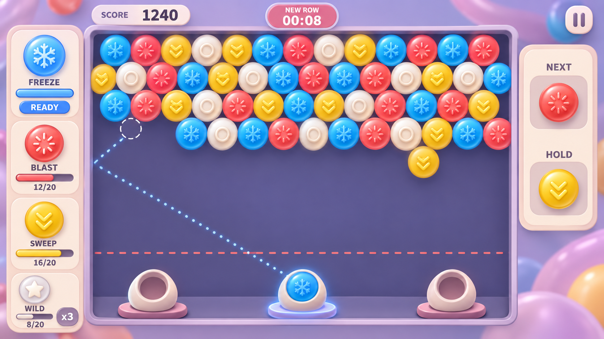

# lxygame-06 开发文档

> 文档日期：2026-09-30
>
> 当前阶段：核心玩法已获认可；本轮增强音效与界面反馈，加入无尽本机排行榜及 30 关目标模式。采用 Objective-C + SpriteKit；实际验证范围和边界见第 13 节。
>
> 产品名称：Gummy Ricochet。

## 1. 开发目标与决策状态

制作一款 iOS 蜂窝棋盘射击消除游戏。玩家从底部发射棋子，以同色连接消除和悬空坠落缓解顶部压行压力，并通过不同颜色积累不同技能能量。

开发顺序采用：先完成无尽原型并验证核心，再扩展产品模式。用户已认可核心玩法，并确认本轮同时保留无尽模式、加入本机多次成绩排行榜及 30 关关卡模式；关卡保留实时压行，用清场、颜色收集、坠落和生存目标形成变化。

本文使用三种状态：

- **已确认**：来自当前讨论中用户明确确定的方向，开发应保留。
- **原型建议**：为使第一版可实现、可测试提出的基线，尚未作为最终产品规则拍板。
- **待定**：影响表现或产品范围的选择，不能在交付时描述成已确认。

| 内容 | 状态 | 说明 |
| --- | --- | --- |
| iOS、蜂窝棋盘、射击、同色 ≥3 消除、悬空坠落、顶部压行 | 已确认 | 核心玩法基础 |
| 蓝色冻结、红色区域清除、黄色底部清除、白色五发万能 | 已确认 | 蓝色 30 秒，红色蜂窝半径 2 格，黄色最底部 4 行，白色 5 发 |
| 不同颜色积攒各自技能能量 | 已确认 | 不改成共享能量池 |
| 左、中、右三个发射位置 | 已确认 | 切换方式与限制为原型建议 |
| 下一发预览、保留槽、墙面反弹 | 已确认 | 操作细节为原型建议 |
| 先验证可玩无尽原型，再决定产品模式 | 已确认 | 本阶段开发顺序 |
| 黄色清除最底部四行、红色命中式爆破 | 已确认 | 黄色横向整行清除；红色可反弹，首个命中点爆破 |
| 技能主动释放、技能不返能、万能单色最大组判定 | 已确认 | 2026-09-30 确认为原型基线；具体边界见第 5 节 |
| 横屏、软糖美术方向与首版样图 | 已确认 | 用户已批准样图，实际棋盘须比样图更密；首版实现采用长行 18 格、短行 17 格 |
| 无尽本机排行榜、30 关目标模式 | 已确认 | 记录多局成绩并按分数排序；关卡保留实时压行和不同目标 |
| 正式名称 Gummy Ricochet | 已确认 | 替换被占用的 Gummy Drop，保留已申请的 Bundle ID |
| 长期平衡 | 待定 | 两种模式均保留，后续真机试玩调参 |

2026-09-30 决策：用户接受前六项推荐方案（黄色范围、红色瞄准方式、主动释放、万能判色、返能限制、横屏），并选择软糖美术。以下仍标为建议的数值、交互边界和工程方案不因此自动升级为最终产品规则。

2026-10-08 技能调整：黄色改为清除最底部 4 行，蓝色冻结改为 30 秒，红色爆破半径翻倍，从蜂窝距离 1 格扩大到 2 格（完整区域最多 19 格），白色万能改为 5 发。无尽模式中，各技能每成功使用一次，下一次所需能量独立增加 1 点，最高 50 点。

2026-09-30 开发授权：用户认可首版软糖完整画面，要求实际棋盘更密，并授权进入开发。主会话负责项目统筹与验收，实际代码和素材工作由 GPT-6.1-sol、high 思考强度子代理完成。首版将棋盘从原建议的 12/11 列提高为 18/17 列；密度的最终手感仍需运行验收。

早期讨论中的穿透、破甲、钻头弹、特殊障碍、危险区倍率、额外颜色和角色养成均不属于本阶段已确认范围，不自动加入。

## 2. 核心体验与完成条件

核心循环：

**观察棋盘 → 选择发射台与当前棋子 → 瞄准直射或反弹 → 发射并落格 → 同色消除 → 悬空坠落 → 按颜色充能 → 选择技能使用时机。**

原型应回答以下问题，而不只证明按钮和动画能够运行：

1. 左中右发射台与反弹是否改变可命中的位置，是否存在值得换位的局面？
2. 下一发与保留槽是否使玩家能主动规划，而不只是等待随机好牌？
3. 四种技能是否各有用途，普通射击是否始终有价值？
4. 压行是否给玩家带来可应对的压力，失败能否归因到可理解的操作或决策？
5. 密集局面是否仍能通过消除、换位或技能重新打开，而不是长时间无有效选择？

完成本阶段需要交付可运行的 iOS 原型、实际操作验证记录和待调整问题清单。只有文档、逻辑单测或模拟数据不能算作可玩原型完成。

## 3. 棋盘与消除规则

### 3.1 棋盘与连接

- 逻辑棋盘采用固定蜂窝格，每格最多一枚棋子，每格最多六个相邻格。
- 顶部一排作为支撑来源。仅与其他棋子相邻、但没有路径连接顶部的棋子，属于悬空部分。
- 普通发射物命中后进入可达的合法空格，再以落点为起点查找同色连通组；数量达到 3 时消除。
- 每次消除后重新检查顶部连接，所有失去支撑的棋子一起坠落，不要求颜色相同。
- 坠落棋子先从逻辑棋盘移除，再播放表现；不撞回棋盘、不再次落格、不重复结算。
- 清空棋盘后，无尽局继续下一波生成；有限波次清场关是否获胜由模式规则决定。

### 3.2 发射与落格

- 发射过程使用棋子的实际碰撞半径，不能仅用无宽度射线判断窄缝是否可穿过。
- 反弹改变水平运动方向；发射角度限制在向上范围，避免接近水平时无限来回反弹。
- 首版建议最多允许一次侧墙反弹。若第二次触墙仍未命中，则视为无效发射方向，不消耗棋子，并在预览中明确表示。
- 命中后的候选落格必须为空、在棋盘内，并可从实际入射一侧到达；不能简单选择几何上最近的空格而把棋子吸进封闭内部。
- 到达顶部时，可落入对应合法空格。无合法落点时，预览与发射均应给出一致结果，不覆盖已有棋子或静默丢弃。
- 瞄准线、预计落点和实际飞行必须复用同一套轨迹与落格计算。

### 3.3 压行与失败

- 顶部定时加入一排新棋子，原棋盘整体下移，原有棋子之间的相对位置和邻接关系保持不变。
- 采用坐标偏移或保留行奇偶相位，避免插入顶行后蜂窝交错关系错误，导致已有棋子横向跳位。
- 建议压行间隔逐阶段缩短，并设置下限；具体曲线通过试玩确定。
- 危险线按棋子碰撞边缘判断，不能只检查中心。已移出逻辑棋盘的坠落动画不触发失败。
- 建议普通发射先完成消除和坠落，再判断剩余棋子是否触线；压行落定后立即判断触线。
- 本轮必要结算结束后判定失败，失败后不再接受射击或技能输入。

## 4. 发射台、预览与保留槽

以下交互细节均为原型建议：

| 机制 | 建议规则 |
| --- | --- |
| 三个发射台 | 同时显示左、中、右位置，但只有一个处于激活状态 |
| 切换 | 发射前可自由切换，切换不暂停压行；飞行、压行和结算期间锁定 |
| 瞄准 | 拖动瞄准、松手发射；支持取消，点击其他功能控件不会误射 |
| 下一发 | 始终显示下一枚普通棋子，确保足够清晰 |
| 保留槽为空 | 存入当前棋子，下一发成为当前棋子，再补充下一发 |
| 保留槽非空 | 与当前棋子交换，不推进下一发队列 |
| 交换次数 | 每次普通发射前最多一次，发射结算完成后恢复；不能无限刷新队列 |

第一版不预设换台次数或冷却。先观察自由换台能否产生有效决策，再决定是否需要额外限制。

必须准备非平整棋盘作为验证场景，包括凹槽、侧面入口和局部缺口。密集实心棋盘会限制射线路径，不能把三个发射点本身当作已有策略深度的证据。

## 5. 颜色与技能

### 5.1 已确认的技能规则

技能采用独立能量槽、充满后主动释放，每种最多储存一次。满槽显示明确可用状态，释放成功后扣除能量，取消瞄准不扣除。

| 颜色 | 已确认能力 | 执行规则 |
| --- | --- | --- |
| 蓝色 | 冻结时间 | 暂停压行倒计时 30 秒，玩家仍可操作；结束后从原剩余时间继续，不补压冻结期间的行数 |
| 红色 | 清除一片区域 | 激活后发射一枚特殊爆破弹，沿正常轨迹命中；以首个命中棋子为中心清除蜂窝距离 ≤2 的区域，再结算悬空坠落 |
| 黄色 | 消除最底部四行 | 清除当前最深占用行及紧邻其上的三行，横向贯穿棋盘，释放前高亮范围 |
| 白色 | 接下来五次发射视为万能棋子 | 给接下来五次普通发射附加万能状态，发射台旁显示剩余次数 |

黄色范围按棋盘当前最深占用行及其上三行计算。每次释放按当前局面计算；不足四行时清除所有现有行，窗口中的空行仍占一行，不采用每列最底部四颗或屏幕底部固定四行的解释。

红色已确定为命中式爆破，支持侧墙反弹，在碰到第一颗棋子时爆炸；通过发射轨迹选择目标，不直接点选棋盘内部。

红色特殊发射建议不推进普通棋子队列、不消耗白色万能次数、不重置保留槽交换机会；爆破确认发射时扣能量。蓝、黄为直接施放，白色为状态激活。

### 5.2 能量基线

无尽模式中，四种技能的门槛独立从 20 点开始：每成功使用一次，该颜色下一次所需能量增加 1 点，最高 50 点。蓝色和白色成功激活、黄色成功清除、红色确认发射时计一次；预览、取消和失败输入不涨价。白色的五次强化射击只算一次技能使用。清空棋盘进入下一波不重置门槛，新开一局重置；暂停和存档恢复保留使用次数与当前能量。关卡模式仍固定为各 20 点。

以下返能限制已确认为原型基线，用于避免技能无限互相供能，后续按试玩结果评估：

- 普通射击直接消除的棋子，按各自原色增加对应能量。
- 普通射击导致的悬空坠落，也按每枚棋子的原色增加能量；不得把整片颜色都计入本发颜色。
- 红、黄技能清除及其引发的坠落，先不返还能量。
- 白色强化射击产生的消除与坠落，先不返还能量。
- 蓝色冻结期间暂停蓝色能量增长，其他颜色按上述规则结算。
- 一个棋子在一次事件中最多计分、充能一次。超出满槽的能量先不储存。

所有事件记录来源：普通射击、白色强化射击、红色爆破、黄色清底。由同一结算入口决定计分和充能，坠落必须保留导致它发生的事件来源。

这些规则已获确认，但平衡仍未验证。尤其要观察白色技能不返能时是否缺乏吸引力。

### 5.3 白色与万能判定

- 普通白色棋子是第四种普通颜色，本身不具备万能能力；消除它用于积攒白色技能。
- 万能次数附着在后续普通发射行为上，不附着在队列或保留槽里的某颗棋子上，避免通过交换复制效果。
- 取消瞄准、切换发射台、交换保留槽不消耗万能次数，成功发射一次才消耗一次。
- 在合法落格后，分别计算相邻各颜色与落点可形成的同色连通组，选择数量最多的一种，将发射棋子转成该颜色，再执行正常三消；一次只匹配一种颜色，此核心判定已确认。
- 不同时合并不同颜色组，不留下永久万能桥梁。并列结果采用固定颜色优先级，预览与实际使用相同规则。
- 没有任何颜色达到三消时，仍转为上述选中颜色并留在棋盘；没有相邻棋子时保持该发原色。
- 发射前显示预计转色与预计消除结果，避免玩家无法理解自动选择。

## 6. 时序、公平性与生成

### 6.1 结算顺序建议

稳定状态可以瞄准、换台、换槽或释放技能。一次发射按以下顺序完成：

1. 确认输入，锁定发射台与队列操作。
2. 沿已计算轨迹飞行，确定合法落点或爆破目标。
3. 落格／技能清除，计算同色消除。
4. 计算悬空坠落，统一结算分数与能量。
5. 检查本轮触线失败；若未失败，处理到期压行，再检查失败。
6. 更新普通发射队列及剩余状态，恢复输入。

压行倒计时在飞行中归零时，先标记到期，等待该发结算后执行；待处理压行完成前不能开始下一发或使用技能。不能通过连续射击无限拖延压行。

未发射时倒计时归零，应执行压行并使旧瞄准预览失效，重新计算后才能发射。不能继续使用移动前的落点。

压行和结算动画的时间处理应独立于动画速度，不能因为设备帧率或特效长短改变难度。后台切换或系统中断时暂停游戏，返回后由玩家继续，不能后台累积压行。

### 6.2 随机生成与可复现

- 棋盘波次与发射队列使用可记录的随机种子，便于复现失败和比较参数。
- 首版保留四种普通颜色，不因预留扩展能力而提前增加颜色数量。
- 棋盘颜色分布、发射颜色候选与技能充能速度需要一起调整，避免某技能因对应颜色长期缺失而不可用。
- 发射队列建议优先从当前棋盘存在的颜色中抽取；棋盘为空时使用本局允许颜色。已经显示的当前、下一发和保留棋子不能因棋盘变化静默换色。
- 随机生成不能当作可解性证明。原型同时保留固定种子的代表性局面和随机长局测试。
- 分数与能量分开结算。原型可先使用“直接消除每枚 10 分、坠落每枚 15 分”，技能清除照常计分但遵守返能限制；这只是调试初值，不加入压线倍率。

## 7. 原型参数起点

以下参数为当前可玩基线。相关规则已有核心和模拟器证据，长期难度与手感仍待真机试玩；参数应集中配置，不散落在场景代码中：

| 参数 | 建议起点 | 主要观察点 |
| --- | --- | --- |
| 棋盘宽度 | 长行 18 格、短行 17 格 | 用户要求比批准样图更密；实际手机上的辨识与瞄准精度仍需验证 |
| 初始棋盘 | 实现为 6 行（100 枚，最下行有缺口） | 开局是否能快速获得第一次消除；早期建议的 4 行已在密度实现时调整 |
| 同色消除阈值 | 3 枚 | 已确认基础规则 |
| 压行间隔 | 从 12 秒起，每 60 秒减少 1 秒，最低 6 秒 | 是否有观察时间，后期是否退化成乱射 |
| 各色能量阈值 | 初始 20 点，无尽模式每种技能成功使用后独立 +1，最高 50；关卡模式固定 20 点 | 首次技能时间、各色可用频率 |
| 蓝色冻结 | 30 秒 | 能否完成有效救场，是否过强 |
| 红色范围 | 中心与蜂窝距离 ≤2 的邻格，最多 19 格 | 半径翻倍，包含空格另一侧的范围内棋子；直接清除与断开支撑的组合价值 |
| 黄色范围 | 最深占用行及其上三行 | 稀疏底部时的价值，是否远强于红色 |
| 白色持续 | 5 次普通发射 | 已确认次数，观察是否稳定产生价值 |
| 侧墙反弹 | 最多 1 次 | 路径是否可读、是否有有效目标 |

蓝色冻结只暂停压行倒计时，原型建议同时暂停难度升级计时，防止冻结结束后立即跳入更高压力阶段；生存时长与分数统计继续。以后若做生存关，应明确冻结不暂停通关计时。

横屏已确认。棋盘高度、危险线和发射台位置应以实际设备布局确定，并验证三发射台与技能面板的可用性。

## 8. 美术方向：软糖（已确认）

### 8.1 材质与整体画面

采用轮廓统一、内部有简洁压印符号的圆形软糖棋子。逻辑仍为蜂窝格，外观不必使用六边形。通过圆润鼓起的表面、柔和高光、轻微透光和受力形变表达软糖质感，保持大面积清晰颜色。

视觉目标：轻松、柔软、可触摸，强调弹跳、挤压和成片坠落。棋子、发射台和控件使用统一的圆润造型语言；颜色与符号共同帮助快速识别。

| 项目 | 建议方向 |
| --- | --- |
| 背景 | 低对比淡紫外围与较深的蓝紫棋盘，奶油色圆角边框；装饰集中在边缘 |
| 蓝色 | 青蓝软糖，雪花压印，对应冻结 |
| 红色 | 珊瑚红软糖，爆裂压印，对应范围清除 |
| 黄色 | 柠檬黄软糖，向下双箭头压印，对应底部清除 |
| 白色 | 乳白软糖，中性环形压印；万能状态使用额外星形和光环 |
| 发射台 | 圆润糖果造型底座，三个位置造型一致，激活态明显 |
| 瞄准线 | 连续可读的细点线，明确反弹拐点、预计落格和目标范围 |
| 消除 | 先轻微挤压再弹开淡出，少量糖果粒子快速收束，不长时间遮住棋盘 |
| 坠落 | 成组脱离、轻微旋转和淡出，优先表达结构变化 |
| 技能状态 | 颜色、符号、填充进度与可用提示共同表达，不只依赖颜色 |

需要控制的风险：软糖高光不能覆盖主体颜色；白色不能与蓝色反光或背景混淆；红黄在强暖光下不能混色。避免为每颗棋子添加脸部或复杂纹理。所有棋子必须在最终手机显示尺寸下检查，而不能只看放大素材。

软糖方向与首版样图已确认。运行界面保留样图的浅紫外围、深紫棋盘、奶油面板、四色压印棋子和三炮台布局，并提高棋盘密度。样图是美术概念，不是可运行游戏截图；运行界面使用独立素材和真实交互节点。

首版样图：[gummy-gameplay-v1.png](docs/art/gummy-gameplay-v1.png)。生成方式及完整提示词见 [样图记录](docs/art/gummy-gameplay-v1-prompt.md)。用户已批准，独立生产素材的提示词见 [资源生成记录](docs/art/gummy-assets-v1-prompts.md)。



### 8.2 风格选择记录

| 方向 | 适合的体验 | 主要取舍 |
| --- | --- | --- |
| 彩色玻璃徽章（未选） | 清晰、精致，突出破碎与坠落 | 不作为本项目当前美术方向 |
| 软糖（已选） | 轻松、圆润，强调弹跳和挤压 | 题材熟悉，靠造型、界面和动效建立辨识度 |
| 珐琅机械徽章（未选） | 触感明确，适合机械发射台 | 不作为本项目当前美术方向 |

首版只选择一种视觉语言，不混用多套材质。原型功能开发可先使用纯色圆片与符号，不等待正式美术才能验证规则。

### 8.3 首轮资源清单

- 普通棋子 4 种，共用尺寸、视觉中心和碰撞轮廓。
- 万能状态覆盖效果 1 套，普通白色与万能状态需明显区分。
- 技能图标 4 个，配套不可用、充能中、可用和激活状态。
- 发射台基础图 1 套，复用于三个位置，并有激活态。
- 当前棋子、下一发与保留槽容器；空槽和已使用状态。
- 棋盘背景、边界、顶部生成提示、危险线。
- 消除、坠落、爆破、冻结和万能效果所需的少量粒子或纹理。
- 暂停、继续和重试等原型基础控件；运行文案采用简短英文。

首批运行资产已生成，全部通过内置 `image_gen` 以批准样图为风格输入；四棋子、炮台和星均有真实 alpha。原图完整保留在 `docs/art/generated-sources/`，运行导出在 `Resources/Images/`，尺寸、裁切与 alpha 信息见 [资源清单](docs/art/asset-manifest.json)。导出仅统一透明边距与尺寸，未改动生成主体。

| 运行资产 | 尺寸 | 用途 |
| --- | --- | --- |
| `gummy_blue.png` / `gummy_red.png` / `gummy_yellow.png` / `gummy_white.png` | 各 256×256；实体直径约 230 | 棋盘、当前弹、下一发、保留槽、技能色标；四种压印为雪花、爆裂、双箭头和环 |
| `cannon.png` | 320×280 | 奶油炮口与粉色底座，复用于三位置 |
| `wild_icon.png` | 128×128 | 独立奶油星，区别普通白棋子与万能状态 |
| `candy_background.png` | 1200×680 | 低对比淡紫环境，只有边缘软糖装饰，无界面烘焙 |
| `menu_hero.png` | 640×480 | 开始页四色软糖与炮台插画，真实透明通道，无烘焙文字 |

界面文本、面板、按钮、能量进度、危险线、瞄准轨迹、落点、技能高亮与激活光环由程序渲染，不能使用整张样图替代交互实现。四棋子的实体 alpha 边界统一为 230×229/230 像素；UI 按约 90% 的画布占比补偿显示，保持逻辑碰撞直径与可见轮廓一致。

## 9. 技术结构建议

本阶段使用 Objective-C + SpriteKit 实现 iOS 无尽与关卡模式，工程由 `project.yml` 管理，最低 iOS 15，支持 iPhone / iPad 横屏；不引入 CocoaPods 或其他第三方依赖。正式产品名称为 **Gummy Ricochet**，工程、Target 与 Scheme 使用 `GummyRicochet`。已申请的 Bundle ID `com.lxygame.gummydrop.prototype` 保持不变。

下表保留规划时的职责划分；实际核心集中于 `Sources/Core/GDEngine.m`，界面由 `GameScene`、`FrontendScene` 和 `GummyUI` 组织：

| 模块 | 职责 |
| --- | --- |
| BoardModel | 蜂窝坐标、占用、邻接、颜色、顶部连接、压行 |
| ShotResolver | 发射半径、轨迹、侧墙反弹、命中与合法落格；供预览和真实发射共用 |
| MatchResolver | 同色组、万能判色、悬空集合 |
| SkillSystem | 分色能量、激活状态、作用范围、冻结与万能剩余次数 |
| RunController | 输入锁定、结算顺序、计时、分数、失败与重新开始 |
| RunRules / GDLevelCatalog | 无尽规则及 30 关初始布局、压行参数、波次、目标与胜负条件 |
| GDRunRecords / GDProgressStore | 本机多局成绩排名、通关进度、最佳星数与分数 |
| GDAudioFeedback | 有限并发的原生素材播放、事件强度、变体与静音控制 |
| GameScene / HUD | 棋盘和界面呈现、触控、动画与反馈，不承担核心匹配判定 |

固定棋盘使用离散规则作为权威状态，不依赖刚体物理决定落格。视觉动画读取结算结果，不能在动画回调中再次推导或重复提交规则结果。

只实现当前需要的模块边界，不为了未来关卡提前制作关卡编辑器、通用脚本系统或复杂插件框架。

## 10. 开发顺序与验收

| 阶段 | 交付内容 | 验收条件 |
| --- | --- | --- |
| A：基础可玩路径 | 蜂窝棋盘、普通发射、落格、三消、坠落、压行、失败、重开 | 可连续游玩，无覆盖棋子、错误悬空或无法继续的状态 |
| B：射击决策 | 三发射台、反弹、下一发与保留槽 | 固定局面证明换台或反弹能改变可命中目标；预览与落点一致 |
| C：技能循环 | 四色充能、主动技能、范围预览、计分 | 全部技能可获得与使用，正确扣能，按约定来源返能，无重复结算 |
| D：压力与手感 | 初始局面、生成、参数调节、触控反馈、最小美术 | 在实际设备上完成代表性试玩，能记录并复现主要失败原因 |
| E：双模式交付 | 无尽本机排行榜、30 关目标模式、独立存档与进度 | 真实无尽结算入榜、关卡通关解锁、双模式冷恢复，以及 30 关核心正向回放 |

A 至 C 是渐进集成顺序，最终原型必须包含全部已确认机制，不能把基础三消完成当作整个原型完成。

### 10.1 必要验证场景

- 发射恰好命中两棋子之间、侧墙边缘、顶部空格和窄缝时，预览与实际结果一致。
- 在平整底面、侧面缺口和深凹槽局面中比较三个发射台，记录实际可攻击位置差异。
- 删除唯一支撑点时正确掉落整片；仍有另一条顶部连接路径时不能误掉落。
- 新增顶行后原棋子的相对位置和邻接保持不变。
- 普通消除、技能清除和各自产生的坠落正确区分能量来源，不能重复充能。
- 万能同时邻接多色、并列组、无法三消、空棋盘时结果明确且可复现。
- 保留槽为空／非空、交换后发射、万能期间交换和爆破发射均遵守队列规则。
- 发射途中压行到期、瞄准途中压行、冻结结束、触线和技能同帧输入具有确定顺序。
- 重开清理全部旧状态和动画回调；后台返回不会突然补压或误判失败。
- 在目标手机尺寸下检查符号、能量、落点、危险线和触控区域是否可辨认、可操作。

逻辑验证适合覆盖坐标、轨迹、连接、队列与时序；操作手感和视觉辨识需运行证据。交付时分别记录编译、模拟器和真机的实际验证状态，不把其中一种描述成全部通过。

### 10.2 调参记录

本地调试记录至少包含随机种子、参数版本、存活时长、每分钟发射量、普通消除量、坠落量、各色技能充满与使用次数、发射台使用分布、反弹与保留槽使用情况、失败前棋盘和最后数次操作。

这些数据用于回答具体问题：是不是某个技能一直无法充满？是不是黄色始终优于红色？是不是玩家始终只用中台？是不是后期只能快速乱射？不要求在原型阶段接入联网分析服务。

## 11. 本轮模式决策

用户确认首版本机排行榜及 30 关关卡模式。无尽记录多次已结束的真实局成绩，按分数由高到低排序，最多保留前 50 条，同分优先较早结束的成绩，同一局只入榜一次；旧版 BEST 分数继续保留，不虚构为一条完整历史成绩。无账户、联网榜或 Game Center 接入。关卡与无尽共享射击、技能和实时压行规则，关卡提供固定初始布局、不同目标和难度参数。

- 清场关：有限波次，最后一波清空获胜。
- 收集关：累计移除指定颜色，包括直接消除、技能清除和悬空坠落。
- 坠落关：累计失去顶部支撑的棋子，直接消除不计入坠落目标。
- 生存关：到达指定生存时间获胜；冻结不暂停通关计时。

通关记录最佳成绩与星数，逐关解锁，可重玩已解锁关卡。生存关按用弹数与目标分数评星；其余目标按用弹数和通关时间评星，未达三星不阻止解锁。30 关使用确定布局和种子，验证记录列出真实核心正向回放结果；不能只以关卡数量或参数增长作为多样性证据。

## 12. 后续待锁定的事项

1. 首批真机测试设备与手感验收；本阶段采用 Objective-C + SpriteKit、最低 iOS 15。
2. 更密棋盘下的实际可读性、触控范围与瞄准精度；软糖样稿已获批准。
3. 原型数值与仍标为建议的交互边界，在实现和试玩中验证。

黄色范围、红色命中爆破、主动释放、万能单色判定、返能限制与横屏已经确认，无需重复确认。

无尽与关卡模式方向已确认，正式名称已确认为 Gummy Ricochet。数值平衡与真机手感仍待后续试玩确定。

## 13. 实施与验证记录

### 首轮原型与界面验收（历史记录）

以下 `ui-v2` 证据对应本轮增强之前的版本；当前音效、排行榜和关卡模式的验收见后续 `experience-v3` 记录。

2026-09-30：实现 Objective-C + SpriteKit 无尽原型，1200×680 横屏逻辑画布、18/17 列蜂窝棋盘、四色独立能量与技能、三炮台、下一发及保留槽。新增开始页、设置页、帮助页；暂停提供 Resume / Retry / Settings / Home，结算提供 Retry / Home。八项运行位图与当时六项本地 WAV 音效随应用打包（当前版本已替换为 15 段原创分层音效），原始生成素材及提示词保留。

设置包含 Sound Effects、Haptics、Aim Guide，默认开启并独立持久保存。游戏在暂停和系统中断时保存可恢复快照；设置页从暂停进入时保留原局，返回仍暂停；冷启动从 Home 的 Resume 恢复快照。安全区内固定比例布局，外围使用同一全屏背景，弹窗遮罩覆盖整个画面。

### 运行与检查

打开 `GummyRicochet.xcodeproj`，选择已有 iOS 模拟器运行 `GummyRicochet`。工程已提交，不要求安装 XcodeGen；修改 `project.yml` 后可使用已安装的 `xcodegen generate` 同步工程。最低 iOS 15，支持横屏 iPhone / iPad，无第三方依赖。

应用图标位于 `Resources/Assets.xcassets/AppIcon.appiconset/`，已配置 iPhone、iPad 与 1024×1024 App Store 图标，全部为无 Alpha 的 RGB PNG。原始生成图及提示词见 `docs/art/app-icon-prompt.md`。提交云端前需重新 Archive，让新图标进入新的安装包；旧归档不会自动包含它。

```sh
DEVELOPER_DIR=/Applications/Xcode.app/Contents/Developer xcodebuild \
  -project GummyRicochet.xcodeproj -scheme GummyRicochet -configuration Debug \
  -sdk iphonesimulator -destination 'generic/platform=iOS Simulator' \
  -derivedDataPath build/DerivedData CODE_SIGNING_ALLOWED=NO build
DEVELOPER_DIR=/Applications/Xcode.app/Contents/Developer scripts/test_core.sh --focused
DEVELOPER_DIR=/Applications/Xcode.app/Contents/Developer scripts/test_settings.sh
```

测试脚本编译独立的 macOS 核心 / 设置测试程序，不属于 XCTest 或模拟器完整端到端测试。`scripts/test_core.sh` 不带参数会执行额外 24 种种子长局；本轮该长跑曾超时，采用明确限定的专项检查替代，未宣称全种子测试通过。

### 已确认的验证证据

- Debug / Release 的 iOS Simulator 构建通过，覆盖最终 WILD 帮助文案、全屏遮罩、炮台装弹位置及 DEBUG 验证日志；摘要：`docs/qa/ui-v2/build-summary.log`。这是模拟器平台编译，不代表真机验收。
- 核心专项共 661 条断言通过：18/17 密度、蜂窝邻接和压行位置保持、453/453 有效角度扫描、预测 / 反弹、匹配 / 悬空、四色能量和技能、队列 / 保留槽、压行优先级、暂停与冷恢复。记录：`docs/qa/ui-v2/core-focused.log`。
- 四条设置检查通过，覆盖默认开启、实例重建后的持久化、设置独立生效及不改局面。记录：`docs/qa/ui-v2/settings-tests.log`。
- 在用户原有的 iPhone 17（iOS 26.4）模拟器上实际触控：Home / Help / Settings 往返、普通 New Game、Hold、左炮台切换、拖动射击得到 395 分、Pause → Settings → Back 仍暂停 → Resume、暂停返回 Home；普通局随压行触发 Game Over，结束页截图不是失败 fixture。三项设置各切 Off 后终止 / 重启仍 Off，收尾时确认三项均 On，保留当前存档与 Home 的 Resume 入口。
- 真实局冷恢复比较的 19 项字段全部一致，包含棋盘、随机状态、当前 / 下一发 / 保留槽、炮台、能量、计时和操作记录；结果：`docs/qa/ui-v2/cold-restore-comparison.json`。这是该次快照的比较范围，未宣称全部存档边界均已验证。
- 真实瞄准运行日志：Aim Guide On 时 `nodes=25 valid=1`，Off 时 `nodes=0 valid=1`，关闭辅助后射击预测仍有效；音效创建取得非零 SystemSoundID。记录：`docs/qa/ui-v2/aim-feedback.log`，不替代音效听感或真机触感验证。

Home / Game / Settings / Help / Paused / Result 六页最终截图已归档到 `docs/qa/ui-v2/`，对应美术验收记录为 `docs/art/ui-v2-art-review.md`；Help 的 WILD 说明已改为 `auto-match a color` 并补取最终运行图。归档说明：`docs/qa/ui-v2/README.md`。`build/` 保留原始截图、完整日志和构建产物，不纳入 Git。真机的音效听感、触感、不同屏幕比例及长期平衡尚未验证；正式名称现已确认为 Gummy Ricochet，长期平衡仍待真机试玩验证。


### 本轮音效、排行榜与 30 关验收（当前版本）

采用 15 段原创分层 WAV 与 AVAudioPlayer 有限并发播放，加入消除/坠落/连消及四技能、Ready、Win 等独立反馈；Sound Effects Off 立即停止声音。无尽保存多局本机成绩，关卡支持四种目标、有限多波、逐关解锁、最佳星数与独立存档。完整分层验收记录和截图/音效/短录屏见 [experience-v3/README.md](docs/qa/experience-v3/README.md)。

| 当前验证 | 结果 |
| --- | --- |
| 最终 Debug / Release | generic iOS Simulator 串行构建均退出 0；Release 保留 HEAD 已有的 GDReadPoint unused 警告。 |
| 30 关核心 | 30/30 正向通关、8043 次断言；focused 回归 661 次断言，设置 4 条检查通过。30 关均有三星 witness，不能据此声称最短解或玩家难度已验证。 |
| 真实 Simulator | 原局自然失败后唯一 1020 分入榜；L1 真实 11 发含红弹、1 次 SWEEP、1 次压行，980 分/2 星，Next 到 L2、冷启动仍解锁。两个模式的恢复快照各 32 项字段全部一致。 |
| 输入与表现时序 | cannon-start / board-start 拖动和左台约 -67° 反弹可实际输入；tap、底部取消不误射。60/120 Hz、抖动、飞行/结算暂停及冷恢复退款通过；clock 巡检前后整个 prefs 不变。多触指仅源码审查。 |
| 资源与视觉夹具 | 15 WAV、8 PNG、最终 levels.json 正确打包；PNG 保留正常 CgBI 优化。排行榜分页和末关结果明确标注 QA FIXTURE，末关夹具前后 prefs 不变。后期长文案用最终目录截图检查。 |

增加的复跑命令：

```sh
DEVELOPER_DIR=/Applications/Xcode.app/Contents/Developer scripts/test_campaign.sh
```

核心/关卡 CLI 在隔离的 UUID defaults suite 中测试，不覆盖玩家偏好。最终应用正常启动停在 Home，保留无尽 Resume、Resume 2、2/30 解锁、2 星与旧 Best 5665；真机声音、静音开关、耳机、触感、其他屏幕比例和长期平衡仍待试玩。音效可听 [audio-preview.wav](docs/qa/experience-v3/audio-preview.wav)，无声真实操作片段见 [feedback-real.mp4](docs/qa/experience-v3/feedback-real.mp4)。
