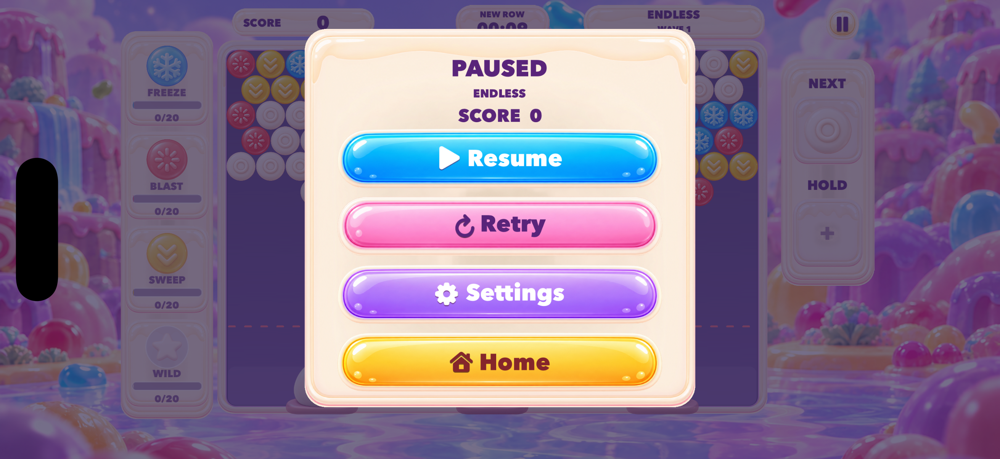

# 暂停弹窗比例调整

日期：2026-10-08。按用户截图调整 PAUSED 弹窗，并根据追加反馈进一步放大。最终版本直接安装、检查于用户当前的 iPhone 17 Pro 模拟器；此前的独立测试设备已关闭。

## 最终布局

| 元素 | 调整前 | 最终 |
| --- | --- | --- |
| 奶油面板 | 454 × 550 | 608 × 590 |
| 四个操作按钮 | 286 × 57 | 512 × 96 |
| 按钮字号 | 22.8 | 36 |
| 按钮图标最大尺寸 | 23 / 26.22 | 36 |

以上为 1200 × 680 的 SpriteKit 场景坐标。四个按钮中心分别为 y=434、328、222、116，间隔一致；按钮图像、字形和图标采用同一中心线。点击矩形由实际按钮尺寸计算。共享按钮绘制允许较大的字号与图标，较小控件仍由自身高度约束内容尺寸。

## 验证

- Debug、Release Simulator 构建均为 `BUILD SUCCEEDED`；使用 `CODE_SIGNING_ALLOWED=NO`，按顺序构建。
- `git diff --check` 通过。
- iPhone 17 Pro，iOS 26.4，设备 `32C8A380-995E-44FD-83D2-1695230AF4F7`：按钮、图标及文字无裁切，四行均处于面板内。
- 从现有无尽存档 Resume 后暂停；Settings → Back 后仍为 PAUSED、SCORE 0、NEW ROW 00:09。最后停留于此弹窗。
- 最佳分、关卡进度、关卡存档、无尽记录和已有设置值均与操作前相同。恢复后再次暂停消耗了少量实际游戏时间，现有无尽存档的 elapsed、pressure、difficulty 及诊断 elapsed 因此发生变化；棋盘及其他存档字段一致。字段对比见 [player-data-comparison.json](player-data-comparison.json)。当前设备没有注入测试存档或执行 Retry。

截图来自当前模拟器原始帧，仅旋转 270°，未进行视觉合成。本次未进行真机验证。完整构建日志位于本地 `build/pause-proportions/`，摘要见 [build-summary.txt](build-summary.txt)。提交保留工作区中原有的隐私政策与工程改动。
